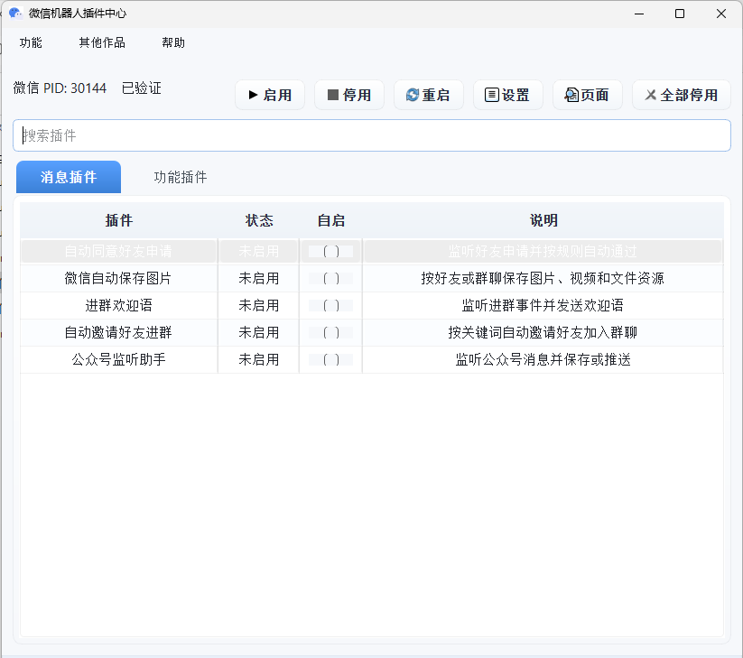

## 项目介绍

此项目是[pywxrobot2.0](https://github.com/kanadeblisst00/pywxrobot2.0)的升级版本，支持微信`4.1.1.19`。~~后面看情况更新到最新版本。目前项目还处于逆向阶段，功能更新会比较缓慢。~~ 如果不出什么问题的话基本会常驻这个版本了。

#### 数据采集需求

**需要公众号历史采集/搜一搜/视频号等数据可以看这个接口: https://wqup3673wn.apifox.cn/**

#### 二次开发接口

**目前给的插件都是开箱即用的，如果有需要进行二次开发的，可以看考虑带HTTP接口的插件：https://pywxrobot4.apifox.cn**

该插件还支持MCP调用，后面会增加skill方式

#### 下载地址

微信安装包太大无法放蓝奏云

网盘下载地址(需要登录)：`https://www.123865.com/s/ihEKVv-Sflx?pwd=vCI5#`

私有网盘地址(免登录)：`http://r5.ikanade.cn:25244/@s/Qp9jxwPV`

微信的话使用安装版(exe)或者绿色版(7z,zip)都可以，后者解压之后就能用，可以和其他版本共存。

## 联系方式

## 功能列表

将所有插件汇总到一起了，可通过一个管理器启动，使用上跟之前的独立程序是一样的。

- [x] [监控公众号推送](https://mp.weixin.qq.com/s/NyLFMiko0ShDLW9QARv7Pg)
- [x] [自动同意好友请求](https://mp.weixin.qq.com/s/RBaP3csZObiHc0vFscWUKA)
- [x] [自动下载文件、图片和视频](https://mp.weixin.qq.com/s/yEv1Cfkr7OTMUZvjidLoiA)
- [x] [关键词自动邀请进群](https://mp.weixin.qq.com/s/_4NO0-v2Tdg1HKlNjNTBSA)
- [x] 群聊消息汇总
- [x] [多余群聊清理](https://mp.weixin.qq.com/s/nZCjv_aNyJQx18kx1CA0nA)
- [x] [根据群聊对好友进行标签分类](https://mp.weixin.qq.com/s/QLDNnVqN4_NGChMFG-LAIg)
- [x] [群成员去重](https://mp.weixin.qq.com/s/PMSFlv9B1nUZer28MW78QQ)
- [x] [导出群成员列表](https://mp.weixin.qq.com/s/JazT5AOYk47SPvhWZTFHHA)
- [ ] 关键词自动回复
- [ ] 群消息关键词预警
- [ ] 批量检测单向好友
- [ ] 进群提示语
- [ ] 导出联系人列表
- [ ] 还没想到

## 使用教程

#### 开始使用

先从网盘下载好指定的微信版本和你需要的插件，然后启动并登录微信，再打开插件按提示操作即可

#### 常见问题总结

请参阅[FAQ.md](./FAQ.md)获取常见问题及解答。

### 二次开发HTTP接口功能列表

#### 接收消息

所有类型消息都会以post请求推送到配置的接口

#### 发送消息

- 文本消息
- 图片消息
- 表情消息
- 名片消息
- 文件消息
- 视频消息
- 引用消息
- 撤回消息
- 文章消息
- 转发消息

#### CDN下载

- 下载图片
- 下载视频
- 下载文件

#### 好友相关

- 获取好友列表
- 获取好友信息
- 获取好友朋友圈状态
- 检测好友状态
- 同意好友申请
- 消息免打扰

#### 群相关

- 获取群列表
- 添加好友进群
- 发送群邀请
- 删除群成员
- 获取群成员列表
- 置顶群消息
- 取消置顶群消息

#### 表情相关

- 获取所有标签
- 新增标签
- 设置好友标签
- 删除标签

#### 其他功能

- 获取自己的信息
- 接收转账
- 退还转账
- 查询消息
- 在独立窗口打开
- 解密图片
- 获取资源路径

