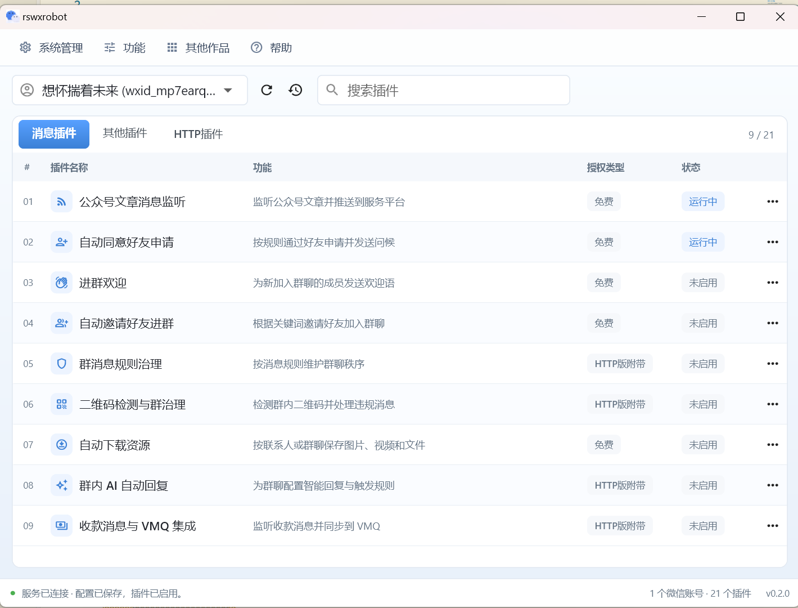
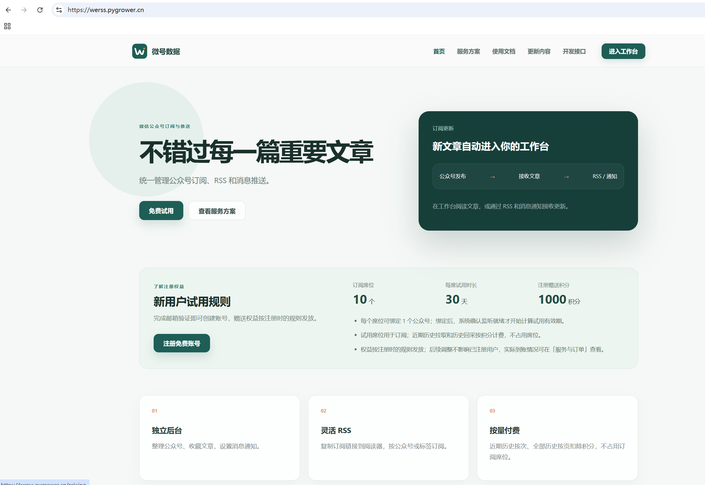

## 项目介绍

这个是微信自动化项目，通过hook实现，版本使用的是`4.1.1.19`。目前有更新版本的计划，近期会有一次版本更新。

pywxrobot4里的插件依旧是免费使用的，收费的是HTTP接口版本(用于二次开发)和部分插件。

#### 公众号采集需求

如果需要监听公众号实时推送可以使用里面的插件来监听消息(免费)，如果不想自己部署的可以看在线服务(按量付费，有试用)：`https://werss.pygrower.cn/`

**需要公众号历史采集/搜一搜/视频号等数据可以看这个接口: https://wqup3673wn.apifox.cn/**

#### 二次开发接口

**目前给的插件都是开箱即用的，如果有需要进行二次开发的，可以考虑带HTTP接口的插件, 接口文档：https://pywxrobot4.apifox.cn**

#### 下载地址

`https://wwbmk.lanzoue.com/b068vkaij 密码:gxs4`

微信安装包太大无法放蓝奏云，请到以下地址里下载：

- 网盘下载地址(需要登录)：`https://www.123865.com/s/ihEKVv-Sflx?pwd=vCI5#`
- 私有网盘地址(免登录)：`https://openlist.ikanade.cn:28443/@s/Qp9jxwPV`
- `https://github.com/cscnk52/wechat-windows-versions/releases/tag/v4.1.1.19`

微信的话使用安装版(exe)或者绿色版(7z,zip)都可以，后者解压之后就能用，可以和其他版本共存。

## 插件列表

- 公众号文章消息监听
- 自动同意好友申请
- 进群欢迎
- 自动邀请好友进群
- 二维码检测和群管理
- 自动下载资源(图片、文件和视频)
- 群内AI自动回复
- VMQ监控端
- 防撤回
- 好友标签分类
- 群成员去重
- 导出好友列表
- 导出群列表
- 导出群成员
- 导出公众号列表
- 群聊天记录导出
- 好友聊天记录导出
- 历史资源补下载(下载最近未失效的图片、文件和视频)
- 导出语音文件

## 联系方式

## 使用教程

#### 开始使用

先从网盘下载好指定的微信版本和你需要的插件，然后启动并登录微信，再打开插件按提示操作即可

#### 常见问题总结

请参阅[FAQ.md](./FAQ.md)获取常见问题及解答。

